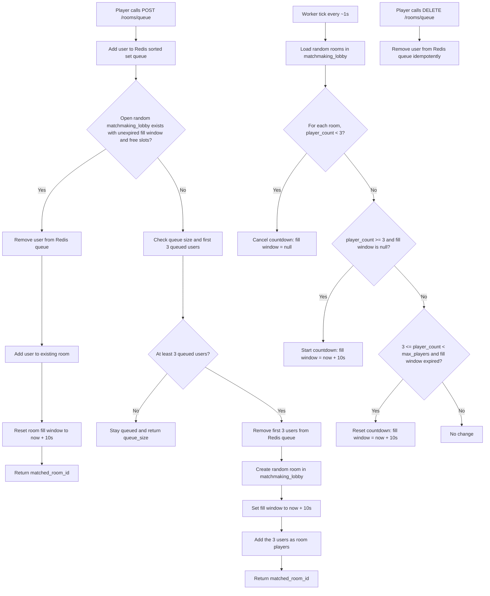

# Phase 2: Backend REST API (Cards & Rooms) - COMPLETE

Phase 2 is closed with all planned REST endpoints implemented and verified in Docker.

## Executive Summary

- Phase 2 target achieved: non-real-time backend API for Cards, User profile, and Rooms.
- Matchmaking queue baseline and countdown maintenance are implemented.
- Endpoint regression suite is green in Docker (`20 passed`).
- Remaining real-time matchmaking/game loop behavior is intentionally deferred to Phase 3.

## Scope Covered

Phase 2 goal in plan: non-real-time backend endpoints for Cards, User profile, and Rooms.

Implemented items:
- Cards endpoints (`GET /cards/default`, `GET /cards/mine`, `POST /cards`, `PATCH /cards/{id}`, `DELETE /cards/{id}`)
- User profile endpoints (`GET /users/me`, `PATCH /users/me`)
- Rooms endpoints (`POST /rooms`, `POST /rooms/join`, `POST /rooms/queue`, `DELETE /rooms/queue`, `GET /rooms/{id}`, `PATCH /rooms/{id}/config`)
- Room schema fields for random flow (`room_kind`, `matchmaking_fill_expires_at`)
- Matchmaking worker service for rolling 10-second countdown start/cancel/reset

## Key Implementation Paths

### Router wiring
- App router registration includes Rooms: `app/main.py` (lines 4, 31)
- Routers package exports Rooms router: `app/routers/__init__.py` (lines 3, 5)

### Rooms API surface
- Rooms endpoints and request handling: `app/routers/rooms.py` (lines 23-120)
  - Create private room: `create_room` (lines 32-43)
  - Join private room: `join_room` (lines 46-56)
  - Enter queue: `join_matchmaking_queue` (lines 59-79)
  - Leave queue: `leave_matchmaking_queue` (lines 82-90)
  - Fetch room details: `get_room_details` (lines 93-101)
  - Patch lobby config: `update_room_config` (lines 104-120)

### Rooms domain logic
- Service implementation: `app/services/rooms.py` (lines 18-364)
  - 6-char unique room code generation: `_generate_unique_room_code` (lines 22-35)
  - Private room creation + host insertion: `create_private_room` (lines 55-86)
  - Private room join + password/capacity validation: `join_private_room` (lines 89-140)
  - Member-only room access guard: `get_room_for_member` (lines 143-156)
  - Host-only lobby config updates: `update_room_config` (lines 176-221)
  - Queue promotion baseline: `enqueue_for_matchmaking` (lines 224-268)
  - Existing matchmaking lobby fill + reset window: `_find_open_matchmaking_room` and `_add_player_to_room` (lines 277-326)
  - Worker countdown logic (start/cancel/reset): `process_matchmaking_tick` (lines 329-364)

### Rooms request/response contracts
- Rooms schema models and constraints: `app/schemas/room.py` (lines 9-92)
  - Create payload constraints: `RoomCreateRequest` (lines 18-26)
  - Join payload constraints: `RoomJoinRequest` (lines 29-34)
  - Host config patch constraints: `RoomConfigUpdateRequest` (lines 37-43)
  - Room details response: `RoomDetailsResponse` (lines 72-76)

### Matchmaking worker
- Worker process entrypoint + polling loop: `app/workers/matchmaking.py` (lines 11-33)
- Compose worker service declaration: `docker-compose.yml` (lines 44-59)

## Matchmaking Process Diagram

## Verification Evidence

Executed in Docker:
- `docker compose config` -> resolved successfully including `worker` service
- `docker compose run --rm backend pytest -q tests/endpoints/test_rooms.py` -> passed (6 tests)
- `docker compose run --rm backend pytest -q tests/endpoints/` -> passed (20 tests)

Rooms-specific tests:
- `tests/endpoints/test_rooms.py` (lines 61-299)
  - Room create/get details
  - Join by code/password and full-room guard
  - Host-only + lobby-only config patch behavior
  - Queue promotion at first 3 players
  - Queue leave idempotency
  - Matchmaking countdown reset on additional queued join
  - Worker tick starts/cancels countdown based on player count

## Behavioral Notes

- Private room passwords are hashed with bcrypt before persistence (`create_private_room`) and verified on join (`join_private_room`).
- Queue promotion creates `random` rooms in `matchmaking_lobby` state with a 10-second fill expiry timestamp.
- If a suitable matchmaking lobby exists and is still open, newly queued users are added there and the 10-second fill window is reset.
- Worker tick logic currently manages countdown timestamps only (state maintenance), while websocket countdown events and game start/lock transitions are Phase 3 responsibilities.

## Out of Scope (Phase 3)

Not part of Phase 2 and intentionally deferred:
- WebSocket room channel and connection manager
- Redis pub/sub room broadcast bridge
- Matchmaking websocket events (`match_found`, countdown events, lock events)
- Game start/round/judging/score loop and reconnect sync

## Follow-up Notes

- Test runs currently emit Pydantic v2 deprecation warnings for class-based `Config`; this does not block functionality but should be cleaned up in a maintenance pass.
- Matchmaking worker currently maintains countdown state transitions; websocket broadcast side effects are planned for Phase 3.

## Phase 2 Exit Criteria Status

- Non-real-time endpoint set implemented: yes
- Queue and room flow implemented: yes
- Containerized verification complete: yes
- Regression suite for endpoints green: yes

Phase 2 is complete and ready for Phase 3 work.
