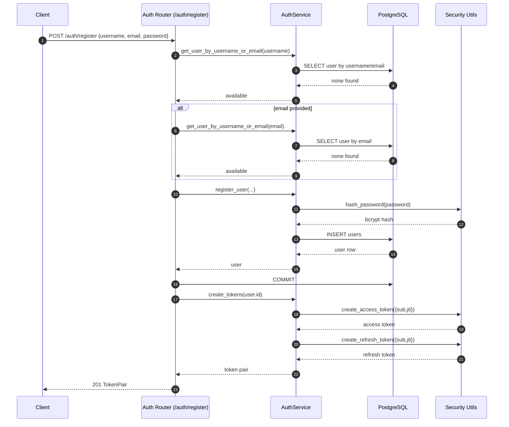
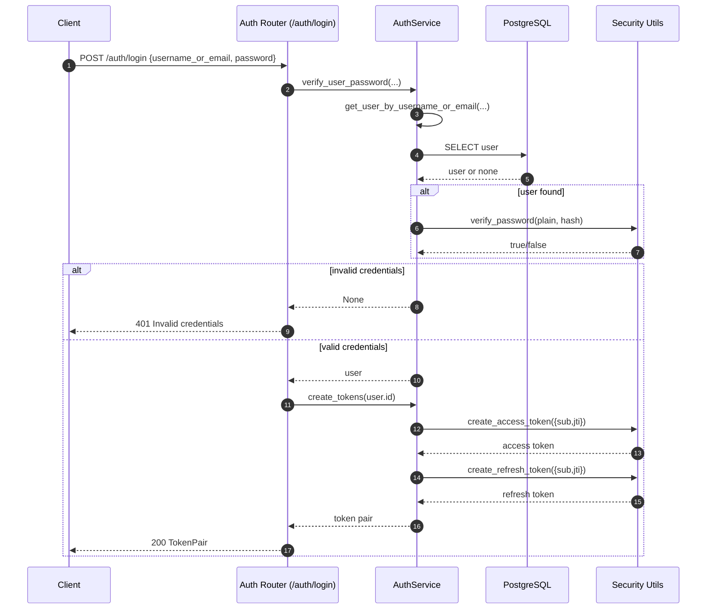
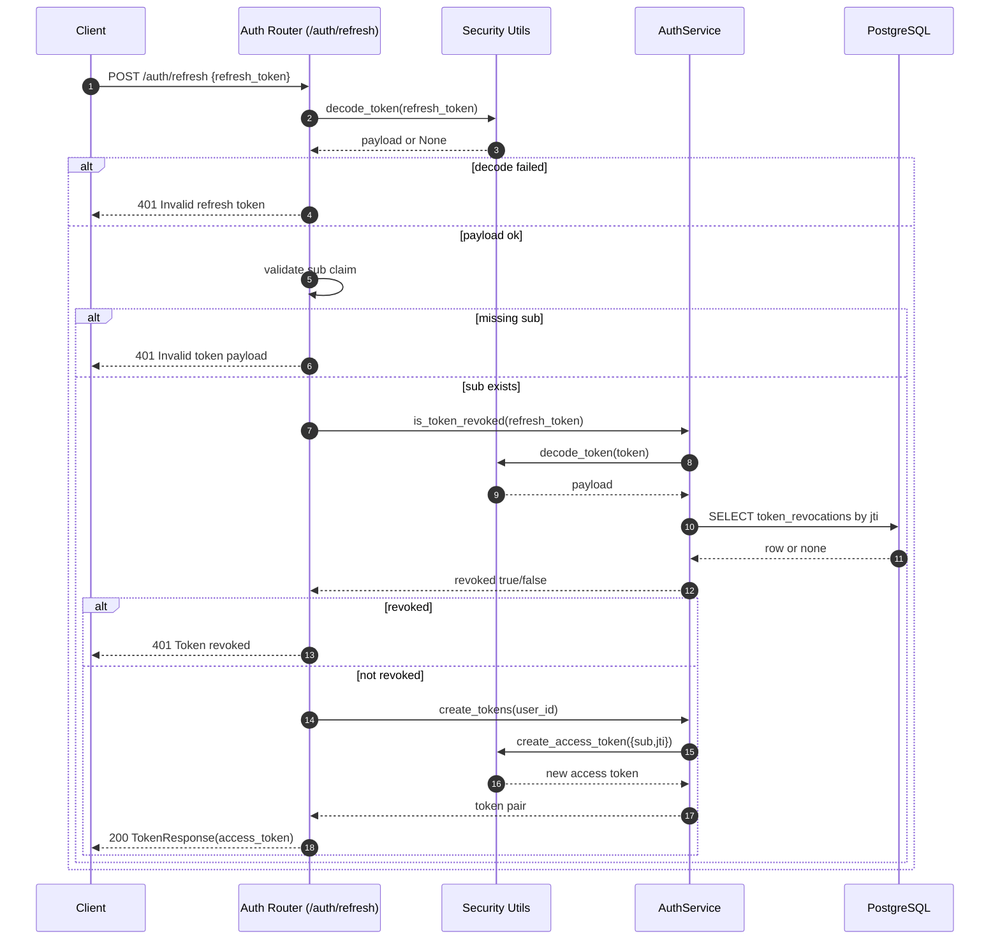
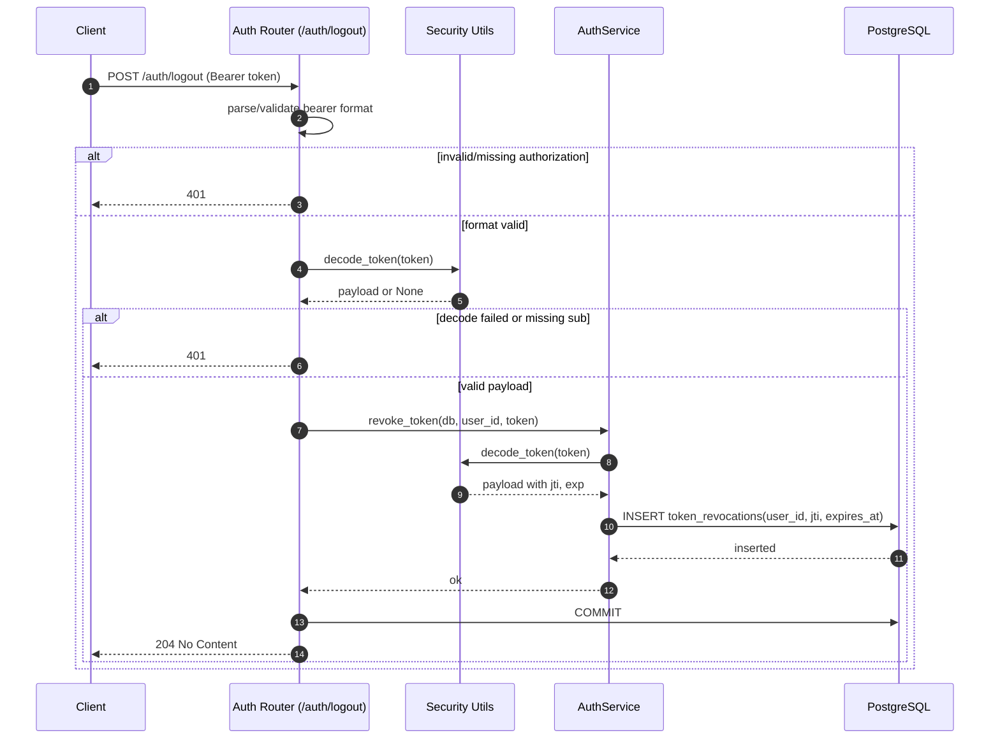
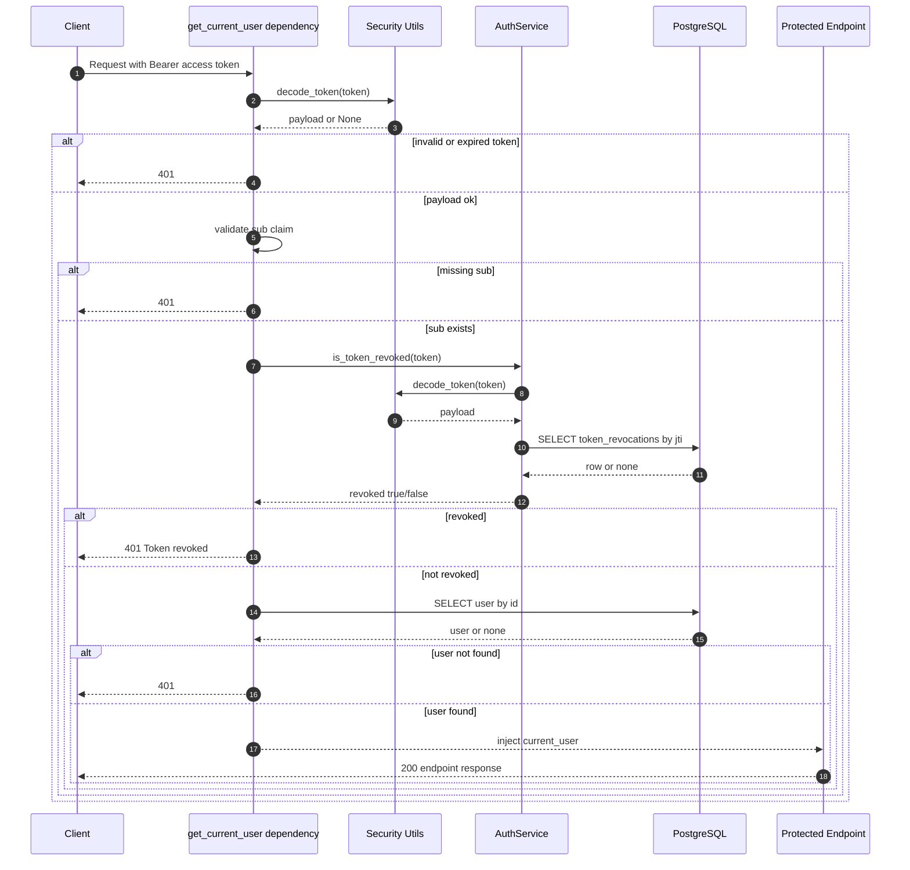
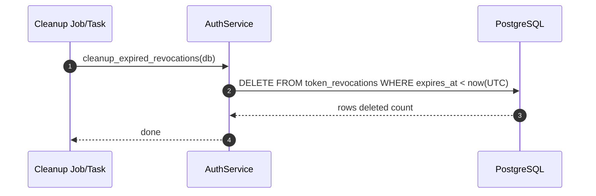

# Authentication and Revocation Sequence Diagrams

This document provides sequence diagrams for the current auth and server-side token revocation implementation.

Related reference document:
- [auth-revocation-and-flow.md](auth-revocation-and-flow.md)

## 1. Register Flow

## 2. Login Flow

## 3. Refresh Flow

## 4. Logout Flow (Revocation Write)

## 5. Protected Endpoint Authentication (Revocation Read)

## 6. Revocation Cleanup Job

## 7. Notes About Current Behavior

- Access and refresh tokens in one issuance share one JTI.
- Refresh currently returns only a new access token.
- Revocation checks are fail-closed (invalid decode or missing JTI treated as revoked).
