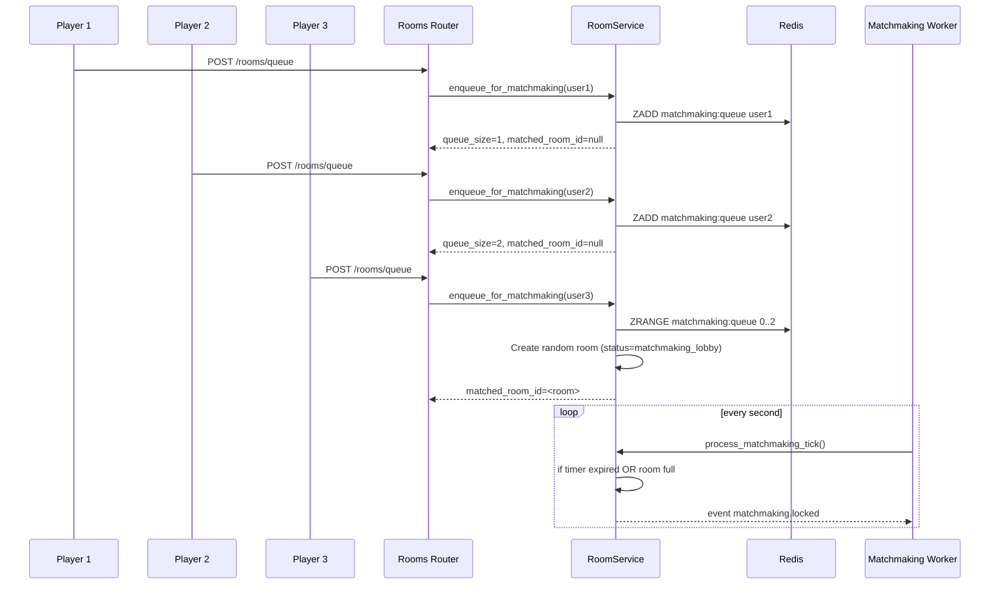
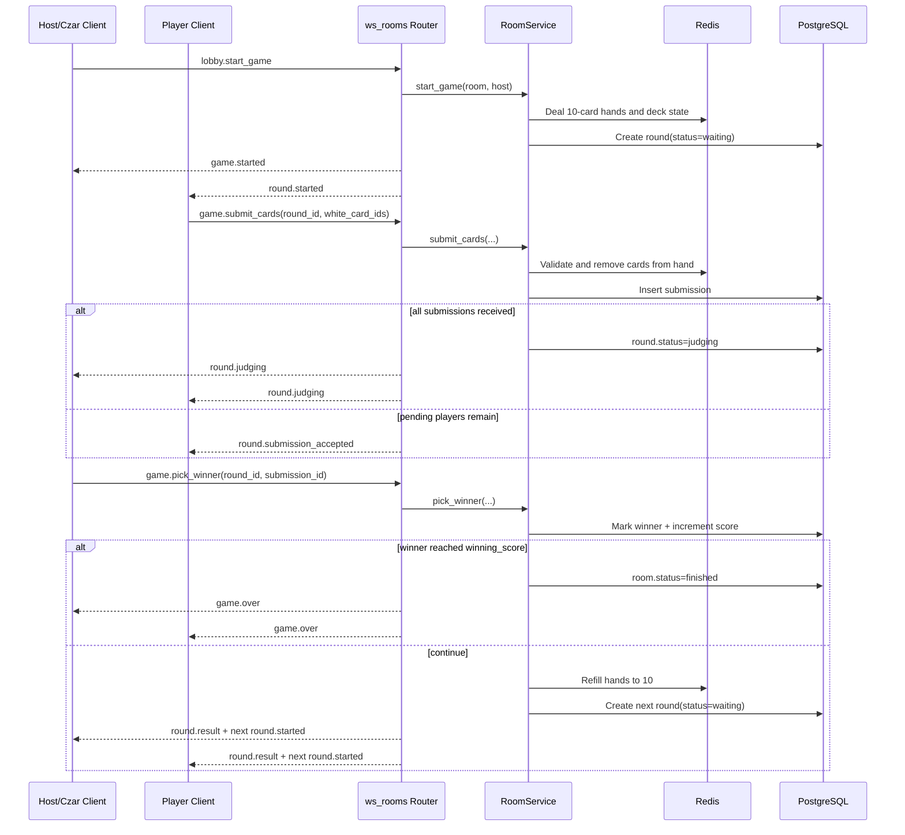

# 5) Rooms, Matchmaking, and Game Engine

This is the core of the backend and the main reason the service layer exists.

## Room Lifecycle

Room operations are exposed from [../../app/routers/rooms.py](../../app/routers/rooms.py) and implemented in [../../app/services/rooms.py](../../app/services/rooms.py).

Private room path:

1. host calls `POST /rooms`
2. service generates unique 6-char code
3. room password is bcrypt-hashed
4. host is inserted as first `RoomPlayer`

Join path:

1. player calls `POST /rooms/join`
2. service validates room exists and is private
3. service verifies room password hash
4. service checks capacity and inserts player with next join order

## Why Join Order Is Central

`join_order` drives two deterministic behaviors:

- host transfer when host disconnects
- czar rotation each round

Determinism matters in multiplayer systems. If ordering is ambiguous, clients diverge in expectations.

## Matchmaking Queue

Random matchmaking uses Redis sorted set `matchmaking:queue`.

Behavior in [../../app/services/rooms.py](../../app/services/rooms.py):

- enqueue user with timestamp score
- if open matchmaking room exists, add user and reset countdown
- otherwise when 3 players are available, create random room with status `matchmaking_lobby`

Background locking logic is in [../../app/workers/matchmaking.py](../../app/workers/matchmaking.py) calling `process_matchmaking_tick`.

## Matchmaking State Machine

- `< 3` players: no active countdown
- `>= 3` players and no timer: start 10-second fill window
- timer expires with 3-9 players: lock and move to `in_progress`
- room reaches max players: lock immediately
- player count drops below 3: cancel countdown

Why worker-based ticking:

- countdown transitions stay server-authoritative
- avoids coupling countdown progression to any single client connection

### Sequence Diagram: Random Matchmaking to Locked Lobby

## Game Start

`lobby.start_game` is handled in [../../app/routers/ws_rooms.py](../../app/routers/ws_rooms.py), delegating to `RoomService.start_game`.

Start validations include:

- caller is host
- room status is startable
- at least 3 players exist

Then service:

1. creates first round
2. selects black card
3. shuffles white deck and deals 10 cards per player into Redis
4. marks room `in_progress`

## Submission Phase

`game.submit_cards` flows to `RoomService.submit_cards` with strict guards:

- room in progress
- round is waiting
- user is not czar
- correct number of cards for black card `pick`
- cards are in submitting user hand
- no duplicate submission

If all required submissions are in, round transitions to `judging`.

## Judging and Winner Selection

`game.pick_winner` triggers `RoomService.pick_winner`:

1. validate czar authority and round state
2. mark winning submission
3. increment winner score
4. either end game or create next round
5. refill all hands back to 10 from Redis deck

This captures a key game invariant: each non-terminal round begins with complete hands.

### Sequence Diagram: One Full Round

## Disconnect Timeout and Czar Skip

`handle_player_timeout` in [../../app/services/rooms.py](../../app/services/rooms.py) removes timed-out users.

Special case:

- if timed-out user is active czar in waiting round, server completes that round and immediately creates next round with next czar

Why this exists:

- avoids deadlocking game progress waiting for a missing czar
- keeps room playable even under unstable connectivity

## One Important Implementation Note

Card pool mode schema supports multiple strategies, but dealing currently selects default white cards. That is intentional current scope and leaves room for later feature expansion without contract redesign.
