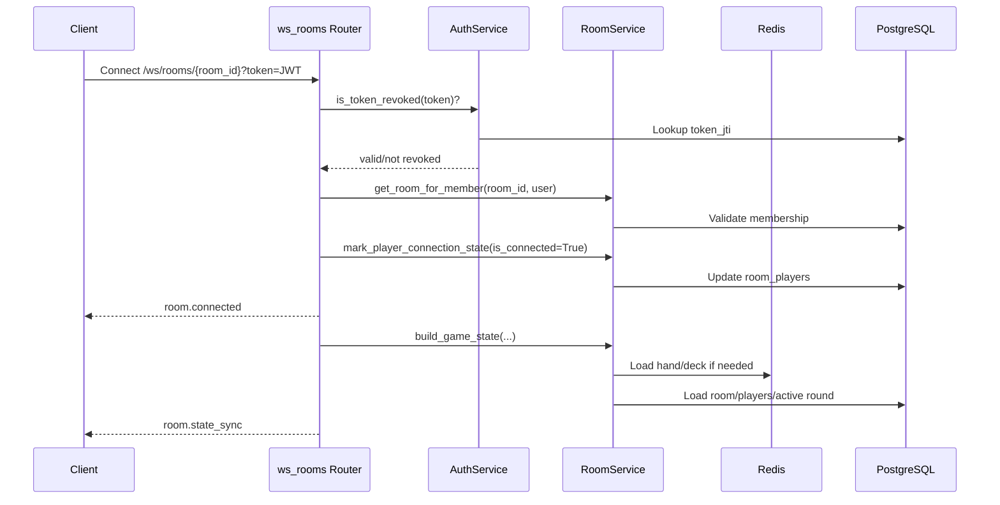
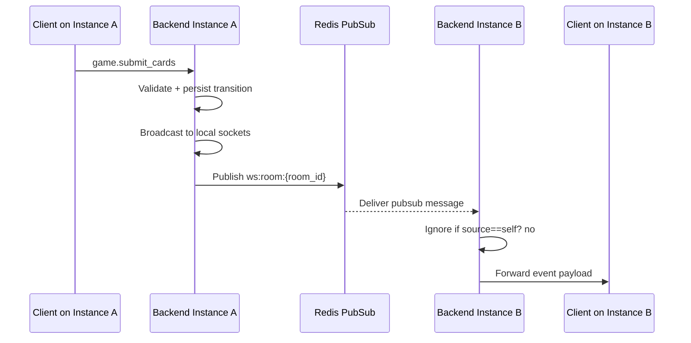
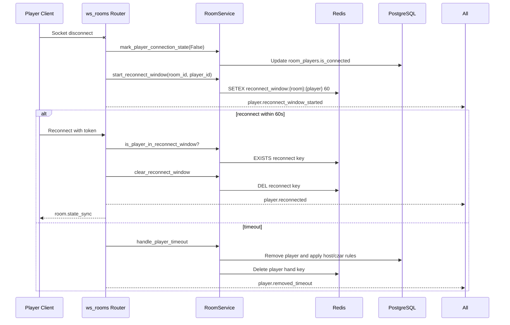

# 6) WebSocket Protocol and Real-Time Flow

## Endpoint and Session Model

Main channel: `GET /ws/rooms/{room_id}?token=<jwt>` in [../../app/routers/ws_rooms.py](../../app/routers/ws_rooms.py).

A connection is room-scoped. After auth and membership checks, server sends:

1. `room.connected`
2. `room.state_sync`

This gives clients enough baseline state to render correctly without extra HTTP fetches.

### Sequence Diagram: Connect and Initial Sync

## Event Envelope

All events use a common envelope from [../../app/schemas/ws.py](../../app/schemas/ws.py):

- `version`
- `event`
- `room_id`
- `message_id`
- `timestamp`
- optional `correlation_id`
- `payload`

Why this pattern:

- uniform logging and tracing
- easier client event dispatcher
- room for request-response correlation in async event streams

## Inbound Commands

Client commands include:

- `client.ping`
- `room.state_sync.request`
- `lobby.start_game`
- `game.submit_cards`
- `game.pick_winner`

Unknown events return structured `error` messages, preserving protocol clarity.

## Outbound Event Families

Presence and lobby:

- `room.player_joined`
- `room.player_left`
- `room.host_changed`

Matchmaking:

- `matchmaking.match_found`
- `matchmaking.countdown_started`
- `matchmaking.countdown_reset`
- `matchmaking.countdown_canceled`
- `matchmaking.locked`

Gameplay:

- `game.started`
- `round.started`
- `round.submission_accepted`
- `round.timer_expired`
- `round.judging`
- `round.result`
- `game.over`

Reconnect lifecycle:

- `player.reconnect_window_started`
- `player.reconnected`
- `player.removed_timeout`

A protocol-focused reference also exists at [../PHASE_3_WEBSOCKET_PROTOCOL.md](../PHASE_3_WEBSOCKET_PROTOCOL.md).

## Cross-Instance Broadcast

`RoomConnectionManager` in [../../app/services/ws_connection_manager.py](../../app/services/ws_connection_manager.py) stores local sockets by room and user.

Broadcast process:

1. send to local sockets
2. publish envelope to `ws:room:{room_id}` in Redis
3. pub/sub bridge on all instances relays payload to their local sockets
4. source instance id prevents rebroadcast loops

Why this matters:

- multiple backend replicas can serve same room reliably
- sender does not need to know where clients are connected

### Sequence Diagram: Cross-Instance Event Fanout

## Round Timer

Round timers are asyncio tasks in [../../app/routers/ws_rooms.py](../../app/routers/ws_rooms.py):

- one task per `(room_id, round_id)`
- canceled if round completes early
- on expiry, auto-submit cards for pending players and transition to judging if complete

This design avoids external schedulers for per-round timing and keeps timer behavior co-located with gameplay command handling.

## Reconnect Window

On disconnect:

1. player is marked disconnected
2. reconnect marker with TTL is written in Redis
3. timeout task is scheduled

If player reconnects in time:

- marker is cleared
- timeout task canceled
- state sync sent
- `player.reconnected` broadcast

If timeout expires:

- player removed from room
- hand removed from Redis
- host transfer / czar-skip logic applied when needed

This provides practical resilience to transient network issues while still guaranteeing eventual cleanup.

### Sequence Diagram: Disconnect, Reconnect, and Timeout

